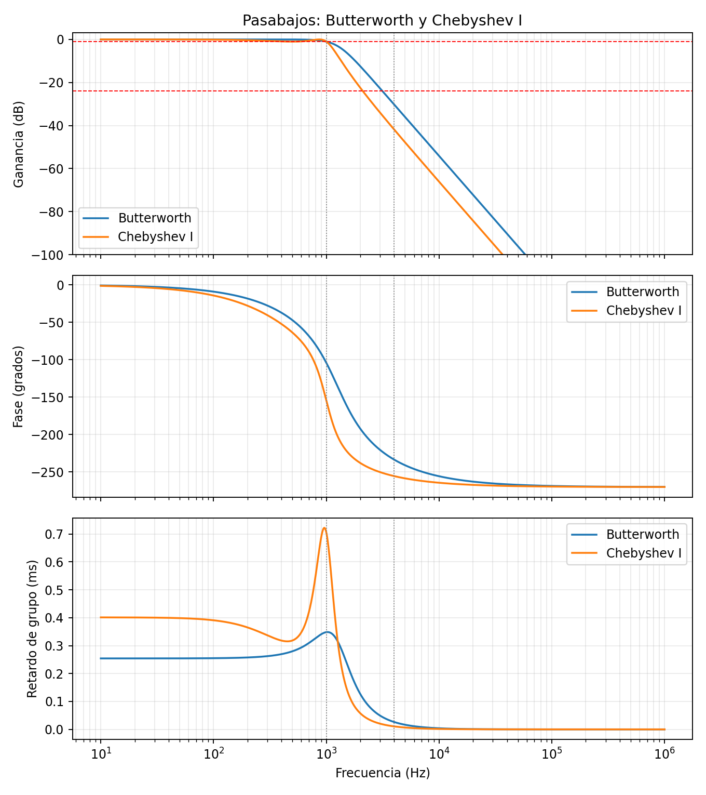
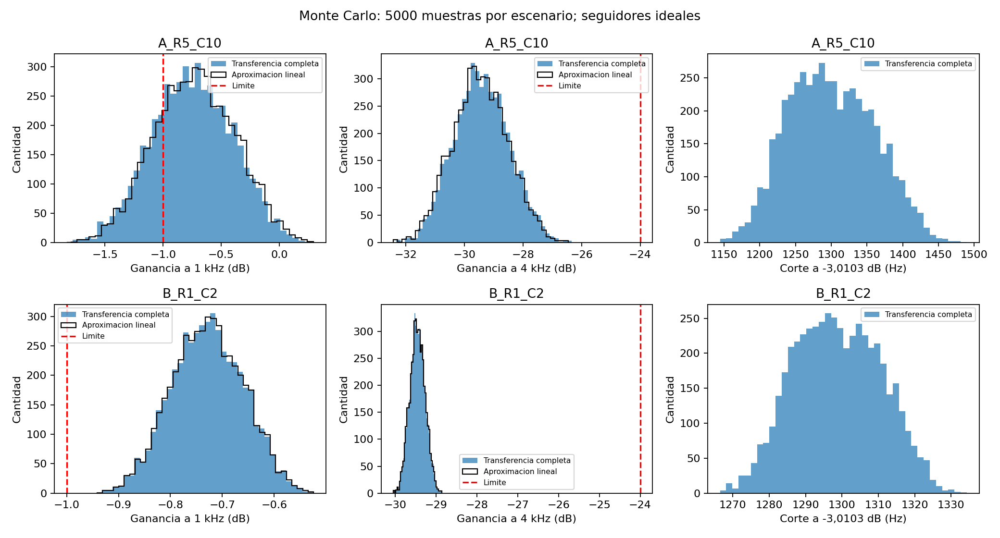

# Síntesis de Redes Activas — Filtros activos

Trabajo práctico del **Grupo 1** de Síntesis de Redes Activas, Facultad de Ciencias Exactas, Físicas y Naturales, Universidad Nacional de Córdoba.

En este repositorio reunimos el diseño matemático, los programas de cálculo y los resultados utilizados para desarrollar un **filtro pasabajos Butterworth de tercer orden**. El trabajo parte de la comparación entre filtros Butterworth y Chebyshev I, continúa con el análisis de sensibilidad de los componentes y se amplía con un estudio estadístico de tolerancias mediante Monte Carlo.

📄 **[Ver el informe completo](Informe_ButterworthO3.pdf)**

## Especificaciones

Se estudian cuatro alternativas: pasabajos y pasaaltos, cada una con aproximación Butterworth y Chebyshev I.

| Especificación | Pasabajos (LP) | Pasaaltos (HP) |
|---|---:|---:|
| Borde de banda de paso, `fp` | 1 kHz | 4 kHz |
| Borde de banda de rechazo, `fs` | 4 kHz | 1 kHz |
| Atenuación máxima en paso, `Ap` | 1 dB | 1 dB |
| Atenuación mínima en rechazo, `As` | 24 dB | 24 dB |

La frecuencia de diseño no representa lo mismo en ambas aproximaciones: en Butterworth corresponde al corte de aproximadamente −3 dB; en Chebyshev I corresponde al borde de la banda de paso con el rizado especificado.

## Organización del repositorio

| Carpeta o archivo | Contenido |
|---|---|
| [`Diseño_Comparación_y_Elección/`](Diseño_Comparación_y_Elección/) | Puntos 1, 2 y 3: diseño de los cuatro filtros, comparación y elección de la alternativa a implementar. |
| [`Diseño_Comparación_y_Elección/Resultados/`](Diseño_Comparación_y_Elección/Resultados/) | Gráficos, respuestas en frecuencia y al escalón, polos, ceros, transferencias y tablas de verificación. |
| [`Sensibilida/`](Sensibilida/) | Punto 6: derivación simbólica de sensibilidades y comparación con perturbaciones de ±1 %. |
| [`MonteCarlo/`](MonteCarlo/) | Análisis estadístico de tolerancias: 5000 muestras por escenario. |
| [`MonteCarlo/resultados/`](MonteCarlo/resultados/) | Valores de los componentes por corrida, histogramas, estadísticas y porcentajes de cumplimiento. |
| [`Informe_ButterworthO3.pdf`](Informe_ButterworthO3.pdf) | Desarrollo del trabajo, simulaciones, implementación y mediciones del prototipo. |


## 1. Diseño, comparación y elección — Puntos 1, 2 y 3

**Programa:** [`puntos_1_2_3.py`](Diseño_Comparación_y_Elección/puntos_1_2_3.py)

### Punto 1: diseño matemático

El programa determina el orden mínimo y la frecuencia de diseño de cada filtro a partir de las especificaciones. Calcula:

- Polos, ceros y factor de ganancia.
- Numerador y denominador de la transferencia.
- Descomposición en secciones de primer y segundo orden.
- Atenuación en los bordes de paso y rechazo.
- Estabilidad y equivalencia numérica entre las representaciones de la transferencia.

Las frecuencias se ingresan en Hz y se convierten a rad/s para el cálculo de los filtros analógicos.

| Filtro | Orden | Frecuencia de diseño | Atenuación en `fp` | Atenuación en `fs` |
|---|---:|---:|---:|---:|
| LP Butterworth | 3 | 1252,58 Hz | 1,00 dB | 30,26 dB |
| LP Chebyshev I | 3 | 1000,00 Hz | 1,00 dB | 41,88 dB |
| HP Butterworth | 3 | 3193,42 Hz | 1,00 dB | 30,26 dB |
| HP Chebyshev I | 3 | 4000,00 Hz | 1,00 dB | 41,88 dB |

### Punto 2: comparación de las respuestas

Se comparan la magnitud, la fase continua, el retardo de grupo y la respuesta al escalón unitario. También se calculan el tiempo de establecimiento y la variación del retardo en la banda seleccionada.

El retardo de grupo se obtiene como _menos la derivada de la fase respecto de la frecuencia angular_; no se calcula dividiendo la fase por la frecuencia.



### Punto 3: elección del filtro

Se selecciona el **pasabajos Butterworth de orden 3** porque cumple las condiciones sin rizado en la banda de paso y permite una implementación mediante:

**RC de primer orden → seguidor de aislamiento → Sallen–Key de segundo orden.**

El factor de calidad de la sección de segundo orden es **Q = 1**. El valor habitual Q ≈ 0,707 corresponde a un Butterworth completo de segundo orden, no a esta sección del filtro de tercer orden.

Chebyshev I ofrece mayor rechazo en el borde especificado, pero ese rechazo adicional no es necesario para cumplir y está acompañado por rizado y una respuesta temporal diferente.

## 2. Sensibilidad de los componentes — Punto 6

**Programa:** [`tpsintesis.py`](Sensibilida/tpsintesis.py)

Se utiliza SymPy para derivar las sensibilidades normalizadas de la frecuencia natural y del factor de calidad de la celda Sallen–Key respecto de cada resistencia y capacitor.

Las derivadas se calculan **antes de imponer igualdades entre componentes**. Luego se evalúan en los valores nominales y se comparan con el cambio obtenido al perturbar un componente por vez en +1 % y −1 %.

El programa también muestra las sensibilidades del polo de la etapa RC. La tabla exportada corresponde a las perturbaciones de los cuatro componentes de la celda Sallen–Key.

**Salida:** [`sensibilidades_punto6.csv`](Sensibilida/sensibilidades_punto6.csv).

Este estudio es determinístico y local: permite identificar qué componentes afectan más a cada parámetro. El Monte Carlo estudia, además, el efecto conjunto de variaciones simultáneas.

## 3. Análisis estadístico de tolerancias — Monte Carlo

**Programa:** [`montecarlo_filtro.py`](MonteCarlo/montecarlo_filtro.py)

Se generan **5000 muestras por escenario**, es decir, **10 000 evaluaciones en total**. Cada muestra utiliza valores distintos de resistencias y capacitores dentro de una distribución uniforme e independiente.

| Escenario | Resistencias | Capacitores |
|---|---:|---:|
| A: tolerancias amplias | ±5 % | ±10 % |
| B: tolerancias reducidas | ±1 % | ±2 % |

Para cada circuito se calculan la ganancia a 1 kHz y 4 kHz, los extremos de ganancia en paso y la frecuencia de corte. Se considera que una muestra cumple cuando satisface simultáneamente:

- Ganancia mínima de **−1 dB** en la banda de DC a 1 kHz.
- Ganancia de **−24 dB o menor** a 4 kHz.

Los valores efectivos y los resultados quedan guardados por corrida para verificar que las muestras sean distintas y repetir el análisis. También se compara la dispersión con la predicción por sensibilidad lineal.

### Configuración utilizada por el script subido

| Componente | Valor nominal |
|---|---:|
| Resistencia de la etapa RC | 12 kΩ |
| Capacitor de la etapa RC | 10 nF |
| Resistencias Sallen–Key | 9,1 kΩ cada una |
| Capacitor de realimentación | 22 nF + 5,6 nF en paralelo |
| Capacitor a masa | 6,8 nF |

Los capacitores de 22 nF y 5,6 nF se varían de forma independiente.

### Resultados guardados en esta carpeta

| Escenario | Cumplen paso | Cumplen rechazo | Cumplen ambas condiciones |
|---|---:|---:|---:|
| A | 75,8 % | 100 % | 3790 de 5000 |
| B | 100 % | 100 % | 5000 de 5000 |



En el histograma de **1 kHz**, la línea roja marca −1 dB: las muestras a la derecha cumplen esa condición. En el de **4 kHz**, marca −24 dB: cumplen las muestras a la izquierda.

El 100 % de cumplimiento en una muestra finita no garantiza todas las combinaciones posibles ni sustituye un análisis de peor caso.

### Correspondencia con el informe

El análisis de sensibilidad y el estudio estadístico del informe emplean **R₀ = 10 kΩ, C₀ = 12 nF y capacitor de realimentación de 27 nF**. El Monte Carlo publicado en esta carpeta conserva los reemplazos indicados en la tabla anterior.

## Cómo ejecutar los programas

Se necesita Python 3 y las bibliotecas NumPy, SciPy, Matplotlib, SymPy y pandas.

### Descargar el repositorio

```bash
git clone https://github.com/francescogallone/SRA_Filtros_Activos.git
cd SRA_Filtros_Activos
```

### Preparar el entorno

En **Ubuntu/Linux**:

```bash
python3 -m venv .venv
source .venv/bin/activate
python -m pip install numpy scipy matplotlib sympy pandas
```

En **Windows con PowerShell**:

```powershell
py -m venv .venv
.\.venv\Scripts\python.exe -m pip install numpy scipy matplotlib sympy pandas
```

Los comandos siguientes usan `python` con el entorno activado. En Windows también se puede sustituir por `.\.venv\Scripts\python.exe` desde la raíz del repositorio.

### Ejecutar los puntos 1, 2 y 3

Desde la raíz:

```bash
python "Diseño_Comparación_y_Elección/puntos_1_2_3.py" --out resultados_locales/diseno
```

Se generan tablas CSV, un resumen JSON, figuras PNG/PDF y una tabla temporal para LaTeX. La opción `--out` permite conservar separados los resultados nuevos y los ya publicados.

### Ejecutar el análisis de sensibilidad

Con el entorno activado:

```bash
cd Sensibilida
python tpsintesis.py
cd ..
```

En Windows, sin activar el entorno, ejecutar `..\.venv\Scripts\python.exe tpsintesis.py` después de entrar en `Sensibilida`.

El programa muestra las expresiones y la comparación de perturbaciones en la terminal, y genera `sensibilidades_punto6.csv` en la carpeta desde la que se ejecuta.

### Ejecutar las 5000 muestras por escenario

Desde la raíz:

```bash
python MonteCarlo/montecarlo_filtro.py --n 5000 --out resultados_locales/montecarlo
```

Los archivos principales de salida son:

| Archivo | Contenido |
|---|---|
| `A_R5_C10.csv` y `B_R1_C2.csv` | Componentes, parámetros y cumplimiento de cada muestra. |
| `muestras_uniformes.csv` | Variaciones normalizadas utilizadas. |
| `sensibilidades.csv` | Coeficientes usados en la aproximación lineal de ganancia. |
| `resumen.json` | Configuración, estadísticas y porcentajes de cumplimiento. |
| `histogramas.png` | Distribuciones de ganancia y frecuencia de corte. |
| `dispersion_bode.png` | Respuestas de 100 muestras de cada escenario, seleccionadas de las 5000 calculadas. |
| `informe.md` | Resumen del procedimiento y sus resultados. |

## Alcance de los resultados

Los programas de diseño y Monte Carlo evalúan **transferencias analógicas con operacionales ideales**. El programa de sensibilidad trabaja sobre expresiones simbólicas de la red. Estos resultados se distinguen de las simulaciones con macromodelos y de las mediciones físicas presentadas en el informe.

Ejecutar los scripts de Python no constituye una corrida en LTspice. Los archivos circuitales de LTspice no están incluidos actualmente en este repositorio.

## Integrantes

- Facundo Alfici.
- Samuele Cravero.
- Pierfelice di Carolo.
- Ludmila Dalmasso.
- Francesco Gallone.
- Dolores Gomez.

**Profesor:** Dr. Pablo Ferreyra.
